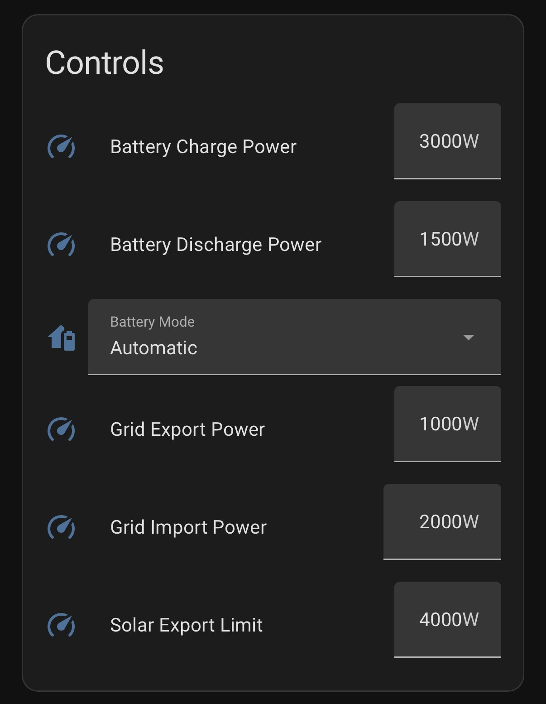
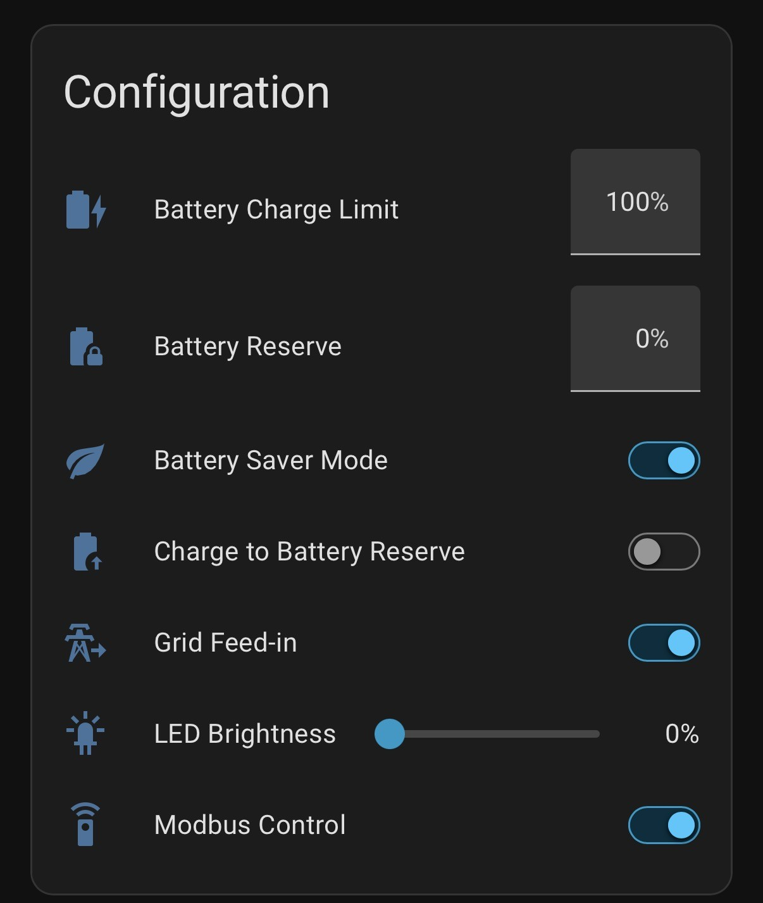

# EF-PowerOcean-TcpModbus

**Local Modbus TCP integration for the EcoFlow PowerOcean home battery system.**

> ⚠️ This integration communicates directly with your device over your local network via Modbus TCP. No cloud connection required.

> [!IMPORTANT]
> Modbus is disabled on the inverter by default. Your EcoFlow partner or installer has
> to enable it before setup, see [Prerequisites](#prerequisites).

<!-- toc depth=3 -->

## Contents

- [Overview](#overview)
  - [Features](#features)
  - [Use Cases](#use-cases)
  - [Screenshots](#screenshots)
  - [Known Limitations](#known-limitations)
- [Getting Started](#getting-started)
  - [Requirements](#requirements)
  - [Installation](#installation)
  - [Configuration](#configuration)
- [Using the Integration](#using-the-integration)
  - [Battery Control](#battery-control)
  - [Sensors](#sensors)
  - [Troubleshooting](#troubleshooting)
  - [Removing the Integration](#removing-the-integration)
- [Project](#project)
  - [Technical Details](#technical-details)
  - [Contributing](#contributing)
  - [Credits](#credits)
  - [Disclaimer](#disclaimer)
  - [License](#license)

<!-- tocstop -->

---

## Overview

### Features

- **Local polling** – no EcoFlow cloud account needed
- **Configurable poll interval** (2–30 seconds, default 5 s)
- Real-time power flow: house consumption, grid import/export, solar generation, battery
- Optional **Battery Controls**: charge, discharge, hold, export, import or export solar first, with state-of-charge guards and a grid feed-in switch
- Full battery monitoring: SOC, voltage, current, power, temperature, remaining energy
- Per-module state of charge for up to 12 battery modules
- Per-string PV power, current and voltage (1–3 strings)
- Per-phase AC measurements: voltage, current, frequency
- Energy counters: daily and lifetime for grid, solar, battery charge/discharge, house consumption
- Operating mode, grid mode and system status as dedicated entities
- Fault reporting: active fault count, and the fault codes with their names where known
- Serial number and firmware version read from the device. The model it reports pre-fills the setup form; the model you select is the one the integration uses
- Settings changeable after setup via **Configure**, and a moved inverter via **Reconfigure** (no re-install needed)
- Debug logging toggle directly in the HA UI
- German and English translations

### Use Cases

- **Energy dashboard:** the lifetime totals for grid, solar and battery feed Home
  Assistant's Energy dashboard directly, without the EcoFlow cloud.
- **Cheap-tariff charging:** an automation charges the battery from the grid while
  electricity is cheap and returns it to Automatic afterwards, using the
  [Set battery command](https://github.com/MaxGrmm/EF-PowerOcean-TcpModbus/blob/main/docs/battery-control.md#commanding-the-battery-from-automations) action.
- **Holding the battery for later:** Hold battery keeps the charge for the evening peak
  while surplus solar is exported.
- **Watching the system:** faults, grid outages and a disconnected battery show up as
  sensors, logbook entries and events, ready to trigger a notification.

### Screenshots

Sensor and diagnostic entities

### Known Limitations

- **Modbus has to be enabled by your installer.** It is off by default and can't be
  switched on from Home Assistant or the regular EcoFlow app.
- **Modbus Control locks out the EcoFlow app** while it is on. Turning it off hands
  control back within about 60 seconds.
- **No automatic discovery.** The inverter doesn't announce itself on the network, so it
  is added by IP address. Give it a reserved address in your router so it can't move.
- **One inverter per entry.** Add each inverter as its own entry.
- **Not every model is tested.** See [Supported Devices](#supported-devices); the
  PowerOcean DC Fit is untested, and controls are untested on several models.
- **Some registers read a constant 0 on some models.** Sensors for those are left out
  on the models concerned rather than showing a value that misleads.
- **The Grid-side sensors need an external EcoFlow Smart Meter.** Without one they are
  disabled; see [Inverter side and grid side](https://github.com/MaxGrmm/EF-PowerOcean-TcpModbus/blob/main/docs/sensors.md#inverter-side-and-grid-side).
- **The protocol is EcoFlow's trial version.** A firmware update can change which
  controls the inverter follows; see
  [Testing the controls after a firmware update](https://github.com/MaxGrmm/EF-PowerOcean-TcpModbus/blob/main/docs/battery-control.md#testing-the-controls-after-a-firmware-update).

---

## Getting Started

### Requirements

#### Prerequisites

> [!IMPORTANT]
> Modbus must be enabled by your EcoFlow partner or installer. It is disabled by
> default!

#### Supported Devices

| Device                       | Read         | Control      |
| ---------------------------- | ------------ | ------------ |
| EcoFlow PowerOcean Plus      | ✅ Confirmed | ✅ Confirmed |
| EcoFlow PowerOcean 3-phase   | ✅ Confirmed | ✅ Confirmed |
| EcoFlow PowerOcean 1-phase   | ✅ Confirmed | ✅ Confirmed |
| EcoFlow PowerOcean DC Fit    | ❓ Untested  | ❓ Untested  |
| EcoFlow Ocean 2 3-phase      | ✅ Confirmed | ✅ Confirmed |
| EcoFlow Ocean 2 1-phase      | ✅ Confirmed | ✅ Confirmed |
| EcoFlow Ocean 2 Plus 1-phase | ✅ Confirmed | ✅ Confirmed |

Running an untested model? [scripts/register_scan.py](https://github.com/MaxGrmm/EF-PowerOcean-TcpModbus/blob/main/scripts/register_scan.py) produces a read-only report comparing your inverter against the register map this integration expects. Attaching its output to an issue is what makes a device supportable, see [Register Scan](https://github.com/MaxGrmm/EF-PowerOcean-TcpModbus/blob/main/CONTRIBUTING.md#register-scan).

#### Home Assistant Versions

Home Assistant **2025.12.0** is the earliest supported version. HACS blocks installing it on older releases, and CI tests every change against both 2025.12.0 and a recent release.

### Installation

#### Via HACS (recommended)

Or install it from within HACS:

1. Open **HACS** in Home Assistant
2. Search for **EF-PowerOcean-TcpModbus**
3. Open it and click **Download**
4. Restart Home Assistant

#### Manual

1. Download the latest release
2. Copy the `custom_components/ef_powerocean_tcpmodbus` folder to your HA `config/custom_components/` directory
3. Restart Home Assistant

### Configuration

1. Go to **Settings → Devices & Services → Add Integration**
2. Search for **EF-PowerOcean-TcpModbus**
3. Fill in the setup form:

| Field                      | Default                | Description                                                                                                                                                                                                                                                                                                             |
| -------------------------- | ---------------------- | ----------------------------------------------------------------------------------------------------------------------------------------------------------------------------------------------------------------------------------------------------------------------------------------------------------------------- |
| IP Address                 | –                      | Local IP of your PowerOcean inverter                                                                                                                                                                                                                                                                                    |
| Port                       | 502                    | Modbus TCP port                                                                                                                                                                                                                                                                                                         |
| Inverter model             | PowerOcean Three Phase |                                                                                                                                                                                                                                                                                                                         |
| Number of Batteries        | 0                      | Number of installed battery modules (0–12), of any size. Sets the battery power limits until the inverter reports its total capacity                                                                                                                                                                                    |
| Maximum solar power        | 12 kW                  | Installed solar power (1–60 kW)                                                                                                                                                                                                                                                                                         |
| Maximum grid power         | 15 kW                  | Your grid connection (main fuse), not the inverter rating. Rejects implausible readings and caps Import from Grid (1–60 kW)                                                                                                                                                                                             |
| Calculation of solar power | false                  | In some inverters, the modbus register delivers 0W of solar power. This switch allows the solar power to be calculated from the individual powers of the string.                                                                                                                                                        |
| Calculation of grid energy | false                  | In some inverters, the grid import and export registers stay at 0 while Grid Power reads right. This switch integrates them from Grid Power instead, see [Grid energy calculated from Grid Power](https://github.com/MaxGrmm/EF-PowerOcean-TcpModbus/blob/main/docs/sensors.md#grid-energy-calculated-from-grid-power). |
| Poll Interval (seconds)    | 5                      | How often values are fetched. Some models have been seen not to keep up with very short intervals; if polls fail or time out, increase it                                                                                                                                                                               |

To change settings after setup: **Settings → Devices & Services → EF-PowerOcean-TcpModbus → Configure**. The collapsed **Correct energy totals** section there is for a lifetime counter the inverter reset; see [Correcting a lifetime total](https://github.com/MaxGrmm/EF-PowerOcean-TcpModbus/blob/main/docs/sensors.md#correcting-a-lifetime-total).

To change the IP address or port, for example after the inverter got a new address: open the entry's **⋮** menu on the same page and choose **Reconfigure**. The new address is tested before it is saved, and refused if a different inverter answers on it.

---

## Using the Integration

### Battery Control

Off by default. Turn on **Modbus Control** (in the Configuration section) to let the
integration control the inverter. This **locks out the EcoFlow app** until you turn it
off again, after which the app takes over within about 60 seconds.

Choose what the battery does with **Battery Mode**:

| Mode               | What happens                                                                      |
| ------------------ | --------------------------------------------------------------------------------- |
| Automatic          | Normal self-consumption, as the app runs it                                       |
| Hold battery       | The battery stays idle; surplus solar is exported                                 |
| Charge battery     | The battery charges at the set power, from the grid if solar falls short          |
| Discharge battery  | The battery discharges at the set power; the rest is exported                     |
| Export to grid     | The grid export stays at the set power; the battery covers the difference         |
| Import from grid   | The grid import stays at the set power; the battery takes what's left             |
| Export solar first | Surplus solar is exported up to the Solar Export Limit before the battery charges |

Each mode's power can be set in advance; only the selected mode's is sent. Charge or
Discharge at 0 W holds the battery. For Export solar first, **Active Control Method**
shows what it is running, and its limit stays 100 W under your export limit so the
inverter never has to curtail solar.

#### Guards

**Charge Limit** stops the battery charging above a level, and **Battery Reserve** stops
it discharging below one. The guards apply in every mode and only ever stop the battery,
never reverse it. Both are off by default.

Turn off schedules in the EcoFlow app, since the inverter follows them whenever it runs
on its own.

#### More on battery control

[docs/battery-control.md](https://github.com/MaxGrmm/EF-PowerOcean-TcpModbus/blob/main/docs/battery-control.md) covers:

- [Guards](https://github.com/MaxGrmm/EF-PowerOcean-TcpModbus/blob/main/docs/battery-control.md#guards): when they release, native and emulated
  reserve, and Charge to Battery Reserve
- [Control Status](https://github.com/MaxGrmm/EF-PowerOcean-TcpModbus/blob/main/docs/battery-control.md#control-status): what each status means,
  and the reading checks that make control step aside
- [Commanding the battery from automations](https://github.com/MaxGrmm/EF-PowerOcean-TcpModbus/blob/main/docs/battery-control.md#commanding-the-battery-from-automations)
  with the Set battery command action
- [Testing the controls after a firmware update](https://github.com/MaxGrmm/EF-PowerOcean-TcpModbus/blob/main/docs/battery-control.md#testing-the-controls-after-a-firmware-update)
  with the Run control test action

### Sensors

The integration creates sensors for power flow, the battery and each module, the PV
strings, the AC side per phase, the inverter's status, faults and limits, and energy
today and in total. The lifetime totals feed Home Assistant's Energy dashboard
directly.

The full list, and how the energy totals are checked and corrected, is in
[docs/sensors.md](https://github.com/MaxGrmm/EF-PowerOcean-TcpModbus/blob/main/docs/sensors.md):

- [Sensor groups](https://github.com/MaxGrmm/EF-PowerOcean-TcpModbus/blob/main/docs/sensors.md#contents)
- [Inverter side and grid side](https://github.com/MaxGrmm/EF-PowerOcean-TcpModbus/blob/main/docs/sensors.md#inverter-side-and-grid-side)
- [Grid energy calculated from Grid Power](https://github.com/MaxGrmm/EF-PowerOcean-TcpModbus/blob/main/docs/sensors.md#grid-energy-calculated-from-grid-power)
- [Correcting a lifetime total](https://github.com/MaxGrmm/EF-PowerOcean-TcpModbus/blob/main/docs/sensors.md#correcting-a-lifetime-total)

### Troubleshooting

<b>Setup fails with “Connection failed - please check IP address and port”</b>

Home Assistant can't open a Modbus TCP connection to the address entered.

1. Check that the IP address is the inverter's, for example in your router's list of
   devices, and that the port is 502.
2. Make sure Home Assistant and the inverter are on the same network, or that the
   networks between them allow port 502.
3. Ask your installer to confirm that Modbus TCP is enabled; it is off by default.

If the form says the inverter takes connections but sends no Modbus replies, the
address is right. In a few cases a firmware update has switched Modbus TCP off: ask your
installer to enable it again.

<b>Repairs shows “The inverter stopped answering Modbus” or “is not reachable”</b>

The inverter has not answered for at least 5 minutes. The entities stay unavailable,
and the issue clears by itself with the next good read.

- **Stopped answering Modbus:** the inverter takes connections on its Modbus port but
  sends no replies.
- **Not reachable:** nothing answers on the port. Check that the inverter is powered and
  still has the same IP address, and use **Reconfigure** if it moved.

In a few cases a firmware update has switched Modbus TCP off. If the inverter updated
recently, ask your installer to enable it again in the EcoFlow Pro app. That is
different from Modbus never having been enabled: the inverter then still answers, and
Repairs shows "Modbus is disabled on the inverter" instead.

<b>Repairs shows “Modbus is disabled on the inverter”</b>

The inverter answers, but every value reads 0, which is how it behaves with Modbus
disabled. Ask your installer to enable Modbus TCP in the EcoFlow Pro app. The issue
clears by itself once readings arrive.

<b>Repairs shows “A different inverter answers”</b>

The address now belongs to another device, usually because the inverter got a new IP
address from your router. Nothing is read or written until this is fixed.

1. Find the inverter's current address and use **Reconfigure** on the entry to change
   it.
2. Reserve that address for the inverter in your router so it doesn't move again.

<b>All entities are unavailable</b>

The connection to the inverter was lost. It is retried automatically and the entities
come back with the next successful poll. If they stay unavailable, check that the
inverter is powered and reachable, and look at the log with debug logging enabled.
Coordinator Status shows why the last poll failed.

<b>A battery mode has no effect</b>

Check **Control Status**: it says when a guard, a full or empty battery, or the export
limit stops a command, and when Modbus Control is off. After a firmware update, run the
[control test](https://github.com/MaxGrmm/EF-PowerOcean-TcpModbus/blob/main/docs/battery-control.md#testing-the-controls-after-a-firmware-update) to see which methods the
inverter still follows.

#### Debug logging and diagnostics

To enable debug logging without editing `configuration.yaml`:

- Settings → Devices & Services → EF-PowerOcean-TcpModbus → Enable debug logging

When reporting a problem, attach the log and the diagnostics download from the device
page, after checking it for anything you would rather not share.

#### Alert verbosity

**Alert verbosity** in the integration's settings sets how much the integration
raises under Settings → Repairs. Each level raises everything the one before it does:

| Level         | Also raises                                                                                                    |
| ------------- | -------------------------------------------------------------------------------------------------------------- |
| **Essential** | Only what you must act on: readings that stopped updating, Modbus off, no answer, held totals (the default)    |
| **Readings**  | A reading check failing, a lifetime counter going back, readings unavailable unexplained, control not accepted |
| **Detailed**  | Frequent reconnects, late polls, repeated control writes with Modbus Control off, power that doesn't add up    |
| **Debug**     | Every warning and error the integration logs                                                                   |

Each kind of alert is one issue, updated at most every 10 minutes with how often and
when it was seen. Open it to ignore it this time, until it goes away and comes back;
for 24 hours; until the next release of the integration; or permanently. Setting the verbosity back to Essential forgets every alert
you ignored. The alerts only watch: they never change what the integration does.
Debug is meant for testing a release on a live inverter.

### Removing the Integration

This integration follows the standard removal process:

1. If **Modbus Control** is on, turn it off first and wait about a minute for the
   EcoFlow app to take over again. Removing the integration with it on also hands
   control back, once the heartbeat stops.
2. Go to **Settings → Devices & Services → EF-PowerOcean-TcpModbus**, open the entry's
   **⋮** menu and choose **Delete**.
3. To uninstall the integration as well, remove it in HACS, or delete
   `custom_components/ef_powerocean_tcpmodbus` for a manual installation, then restart
   Home Assistant.

Deleting the entry also deletes the energy counters and control state the integration
saved. Reports of control tests stay in the `ef_powerocean_tcpmodbus` folder of your
configuration directory; delete it if you no longer need them.

---

## Project

### Technical Details

#### How data is updated

The integration polls the inverter over your local network every **Poll Interval**
(5 seconds by default, 2–30 configurable). Each poll reads only the registers that
enabled entities, the control loop and the reading checks need, so disabling sensors
you don't use makes polls lighter. The serial number and firmware are read again each
time the connection opens.

A request the connection loses, such as when the inverter closes an idle connection, is
sent once more on a new connection. If a poll still fails, the entities become
unavailable until the next one succeeds. A lost connection is retried within the poll
after 0, 5, 10 and 20 seconds, then again 30 seconds later. If the inverter can't be
reached when Home Assistant starts, the setup is retried automatically in the
background.

With Modbus Control on, a heartbeat is written to the inverter independently of the
polls, to keep control from passing back to the EcoFlow app.

#### Protocol

- **Protocol:** Modbus TCP (port 502), reading holding registers and writing single
  or multiple registers
- **Tested firmware:** 3.0.19.19 + 3.0.20.54(PO+)
- **Tested pymodbus version:** 3.6.9, 3.11.x and 3.13.x

The register map lives in [`const.py`](https://github.com/MaxGrmm/EF-PowerOcean-TcpModbus/blob/main/custom_components/ef_powerocean_tcpmodbus/const.py) as absolute Modbus addresses. Word order, decoding, how reads are grouped into blocks and known gaps are in the [protocol notes](https://github.com/MaxGrmm/EF-PowerOcean-TcpModbus/blob/main/EcoFlow_PowerOcean_Modbus.md).

### Contributing

Contributions use personal forks and pull requests. See
[CONTRIBUTING.md](https://github.com/MaxGrmm/EF-PowerOcean-TcpModbus/blob/main/CONTRIBUTING.md) for setup, testing, safety requirements, and the
review checklist.

### Credits

Special thanks to all contributors for the massive amount of time and effort that helped this project grow so fast!

  <a href="https://github.com/windmark">
     
    windmark
  </a>

  <a href="https://github.com/fuchsi585">
     
    fuchsi585
  </a>

  Kater Carlo

### Disclaimer

This integration follows EcoFlow's Open Modbus Protocol V1.0, a trial version,
corrected by community measurements where the hardware differs from it. See the
[protocol notes](https://github.com/MaxGrmm/EF-PowerOcean-TcpModbus/blob/main/EcoFlow_PowerOcean_Modbus.md#where-the-specification-and-the-hardware-disagree).
Use at your own risk. Not affiliated with EcoFlow Technology Co., Ltd.

### License

MIT License – free to use, modify and distribute with attribution.
